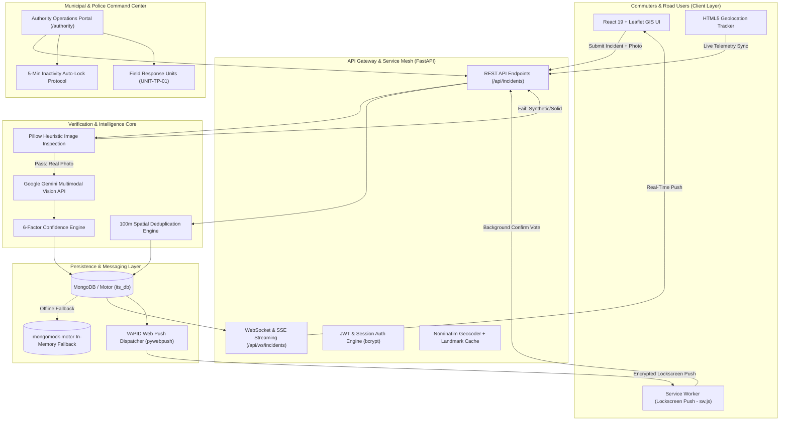
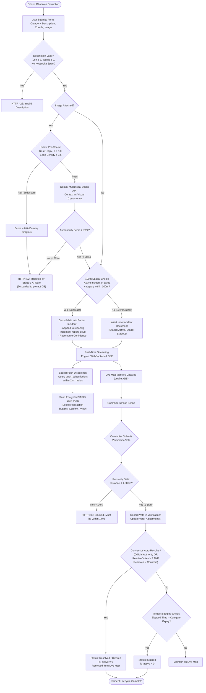
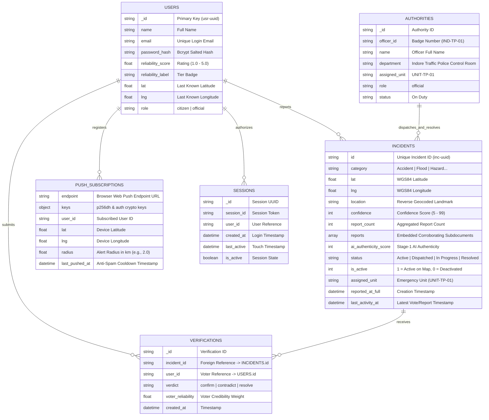

# INTELLIGENT TRANSPORTATION SYSTEM (ITS)
## AI-Powered Crowdsourced Incident Monitoring, Multi-Stage Verification & Spatial Emergency Response

**Institution:** Gati Shakti Vishwavidyalaya (GSV), Vadodara, Gujarat  
**Domain:** Smart Mobility, Transportation Engineering & Intelligent Logistics Infrastructure  
**Project Repository:** `Intelligent-Transportation-System-Project`  
**Document Version:** 1.0.0 (Comprehensive Academic & Technical Documentation)  

---

## 1. Executive Summary & Problem Formulation

Modern road networks face severe bottlenecks due to sudden disruptions: vehicular collisions, monsoon waterlogging, fallen trees, infrastructure degradation (potholes), and unplanned lane blockages. Conventional traffic monitoring solutions (e.g., standard GPS navigation apps) present critical limitations:
1. **Passive Telemetry Lag:** Slowdown is only recognized *after* substantial vehicular queues form.
2. **Vulnerability to Spam & Fabrication:** Traditional crowd-reporting tools accept unverified, fabricated, or meme uploads.
3. **Stale Information:** Incidents persist on maps long after tow trucks or civic workers clear the scene.
4. **Disjointed Emergency Response:** Municipal traffic authorities and police lack unified digital channels to dispatch units and officially resolve public alerts.

This **Intelligent Transportation System (ITS)** introduces a closed-loop socio-technical architecture designed for urban and national transit corridors:
* **Citizen-Led Crowdsourcing:** Road users report disruptions in real-time with GPS coordinates and photographic evidence.
* **Stage-1 Multimodal AI Screening:** Computer vision (Google Gemini Multimodal Vision + Pillow pre-filtering) validates photographic proof against reported descriptions before database entry.
* **Geospatial Clustering (100m):** Merges duplicate reports into single high-credibility incidents.
* **Dynamic 6-Factor Confidence Engine:** Computes an evolving credibility index ($5\%$ to $99\%$) incorporating voter reliability and category-specific half-life decay.
* **Proximity-Gated Verification (1,000m):** Only road users physically within $1\text{ km}$ can confirm, contradict, or resolve hazards.
* **Spatial Web Push & Live Streaming:** Low-latency WebSockets and VAPID lockscreen push notifications alert drivers within a $2\text{ km}$ radius.
* **Authority Operations Portal:** A dedicated operations interface with Role-Based Access Control (RBAC) and a 5-minute inactivity security lock for traffic police and dispatchers.

---

## 2. End-to-End System Architecture



---

## 3. Technology Stack Matrix

| Layer / Subsystem | Technology | Version | Specific Task & Justification |
| :--- | :--- | :--- | :--- |
| **Frontend Framework** | React | `^19.2.8` | Component-based reactive state rendering, single-page application (SPA). |
| **Build & Dev Tool** | Vite | `^8.2.2` | High-speed ESM bundling, route-level code-splitting with `React.lazy` and `Suspense`. |
| **Client-Side Routing** | React Router DOM | `^7.18.2` | Protected routes (`RequireAuth`), route parameters (`/app/incidents/:id`), navigation guards. |
| **GIS Mapping** | Leaflet & React-Leaflet | `^1.9.4` / `^5.0.0` | Interactive map canvas, custom category SVG pins, pulsing user GPS marker, route polylines. |
| **Spatio-Temporal Analytics** | Leaflet.heat | `^1.0.0` | Dynamic heatmap rendering of incident frequencies across transit corridors. |
| **Background Push Worker** | Web Service Worker | Native (W3C) | Lockscreen push listener, OS notifications, direct quick-action buttons (`confirm`, `view`). |
| **Backend Framework** | FastAPI | `0.115.0` | Asynchronous high-concurrency Python REST & WebSocket framework with OpenAPI auto-docs. |
| **ASGI Server** | Uvicorn | `0.30.6` | Async event-loop worker running FastAPI on standard ports. |
| **Database Engine** | MongoDB (Motor) | `3.4.0` | Asynchronous NoSQL document store for nested report clustering and geospatial documents. |
| **In-Memory Fallback** | mongomock-motor | `^0.0.36` | In-memory mock MongoDB engine for zero-downtime execution when MongoDB service is offline. |
| **Schema Validation** | Pydantic | `>=2.10,<3` | Strict contract enforcement, automatic type conversion, and camelCase JSON aliasing. |
| **Multimodal Vision AI** | Google Gemini Vision API | `gemini-3.1-flash-lite` | Multimodal model inspecting uploaded photos against user descriptions (authenticity scoring). |
| **Image Pre-Inspection** | Pillow (PIL) | `>=10.0.0` | Local color variance, edge density calculation, and solid dummy graphic detection. |
| **Web Push Cryptography** | pywebpush & py_vapid | `>=2.0.0` | VAPID EC P-256 keypair generation, RFC 8291 payload encryption, push dispatching. |
| **Authentication & Tokens** | Passlib & Python-Jose | `1.7.4` / `3.3.0` | Bcrypt password salting and hashing; HS256 JWT generation with MongoDB session tracking. |
| **Geocoding Service** | OpenStreetMap Nominatim | API v1 | Forward/reverse geocoding with server-side LRU/TTL caching and local surveyed landmarks. |

---

## 4. Mathematical Formulations & Algorithmic Models

```
┌─────────────────────────────────────────────────────────────────────────────────────────────────┐
│                                   CORE MATHEMATICAL ENGINES                                     │
├──────────────────────────────┬───────────────────────────────┬──────────────────────────────────┤
│ 1. Haversine Formula         │ 2. Diminishing Returns        │ 3. Category Half-Life Decay      │
│    (Spherical Earth Distance)│    (Report Frequency Factor)  │    (Freshness Factor)            │
│                              │                               │                                  │
│         d = R · c            │     F(N) = 1 - 0.60^N         │     T = 2^(-Δt / t_half)         │
└──────────────────────────────┴───────────────────────────────┴──────────────────────────────────┘
```

### 4.1. The Haversine Great-Circle Distance Metric
Flat Euclidean distance ($\sqrt{\Delta x^2 + \Delta y^2}$) introduces intolerable errors when measuring GPS coordinates due to Earth's spherical curvature. The Haversine formula determines the exact shortest distance over the curved surface:

$$\Delta \phi = \text{lat}_2 - \text{lat}_1, \quad \Delta \lambda = \text{lng}_2 - \text{lng}_1 \quad \text{(in radians)}$$

$$a = \sin^2\left(\frac{\Delta \phi}{2}\right) + \cos(\phi_1) \cdot \cos(\phi_2) \cdot \sin^2\left(\frac{\Delta \lambda}{2}\right)$$

$$c = 2 \cdot \operatorname{atan2}\left(\sqrt{a}, \sqrt{1 - a}\right)$$

$$d = R \cdot c$$

where $R = 6,371,000\text{ meters}$ ($6,371\text{ km}$).

**System Enforcements:**
* **$d \le 100\text{ m}$:** Triggers automatic report deduplication and consolidation.
* **$d \le 1,000\text{ m}$ ($1.0\text{ km}$):** Proximity gate for community verification votes.
* **$d \le 2,000\text{ m}$ ($2.0\text{ km}$):** Spatial boundary for targeted Web Push alerts.

---

### 4.2. Frequency Factor Formula ($F$) with Diminishing Returns
To model the credibility gained when multiple independent witnesses report the same disruption without allowing runaway scores, a diminishing marginal returns formula is applied:

$$F(N) = \min\left(1.0, \; 1.0 - 0.60 \times (0.60)^{N - 1}\right)$$

where $N$ is the count of corroborated reports:
* $N = 1 \implies F(1) = 1.0 - 0.60 \times 1.0 = \mathbf{0.400}$ ($40\%$)
* $N = 2 \implies F(2) = 1.0 - 0.60 \times 0.60 = \mathbf{0.640}$ ($64\%$)
* $N = 3 \implies F(3) = 1.0 - 0.60 \times 0.36 = \mathbf{0.784}$ ($78.4\%$)
* $N = 4 \implies F(4) = 1.0 - 0.60 \times 0.216 = \mathbf{0.870}$ ($87\%$)
* $N \ge 5 \implies F(N) \ge \mathbf{0.922} \to \mathbf{1.000}$

---

### 4.3. The Dynamic 6-Factor Confidence Score ($S_{\text{final}}$)

The base confidence $S_{\text{base}}$ ($0$ to $100$) integrates multimodal visual evidence, crowd frequency, user reputation, and baseline road characteristics:

$$S_{\text{base}} = \Big(w_1 \cdot M + w_2 \cdot F + w_3 \cdot U + w_4 \cdot RR\Big) \times 100$$

* **$M$ (Media Alignment):** AI authenticity score $[0.0, 1.0]$ evaluated by Gemini Vision.
* **$F$ (Frequency):** Derived from the diminishing marginal returns formula.
* **$U$ (Reporter Reliability):** Normalized credibility score of reporting citizen $[0.1, 1.0]$:
  $$U = \max\left(0.1, \; \min\left(1.0, \frac{\text{ReliabilityScore}}{5.0}\right)\right)$$
* **$RR$ (Road Rating):** Static contextual roadway rating factor (calibrated to $0.70$).

#### Adaptive Weight Redistribution:
* **With Media:** $w_1 = 0.40$, $w_2 = 0.35$, $w_3 = 0.15$, $w_4 = 0.10$ ($\sum w_i = 1.00$).
* **Without Media ($w_1 = 0$):** $w_1$ is redistributed proportionally across remaining factors:
  $$w_2 = \frac{0.35}{0.60} \approx 0.5833, \quad w_3 = \frac{0.15}{0.60} = 0.2500, \quad w_4 = \frac{0.10}{0.60} \approx 0.1667$$

---

### 4.4. Voter Reliability Adjustment ($R$)
Community votes modify the base score, scaled by the voter's established reputation ($R_{\text{voter}} \in [1.0, 5.0]$):

$$V_{\text{norm}} = \frac{R_{\text{voter}}}{3.0}$$

$$R = \sum_{\text{confirm}} \left(+5.0 \times V_{\text{norm}}\right) - \sum_{\text{contradict}} \left(-8.0 \times V_{\text{norm}}\right)$$

> Contradictions carry an $8.0$ penalty versus a $5.0$ reward for confirmations, ensuring false alarms and cleared scenes rapidly lose confidence.

---

### 4.5. Category-Aware Temporal Decay / Half-Life ($T$)
The freshness factor $T \in [0.05, 1.0]$ models physical clearance rates using exponential decay:

$$T = 2^{-\Delta t / t_{1/2}}$$

where $\Delta t$ is the elapsed minutes since the latest verified activity, and $t_{1/2}$ is the category half-life:

| Incident Category | Half-Life ($t_{1/2}$) | Auto-Expiry Limit | Clearance Rationale |
| :--- | :--- | :--- | :--- |
| **Traffic Jam** | $90\text{ min}$ ($1.5\text{ h}$) | $3.0\text{ hours}$ | Congestion shifts and dissolves rapidly as flow redirects. |
| **Accident** | $180\text{ min}$ ($3.0\text{ h}$) | $6.0\text{ hours}$ | Cleared once emergency vehicles, ambulances, and wreckers arrive. |
| **Waterlogging** | $480\text{ min}$ ($8.0\text{ h}$) | $24.0\text{ hours}$ | Water recedes slowly through stormwater drainage networks. |
| **Road Blockage** | $720\text{ min}$ ($12.0\text{ h}$) | $24.0\text{ hours}$ | Requires heavy machinery, cranes, or barricade removal. |
| **Road Hazard** | $1440\text{ min}$ ($24.0\text{ h}$) | $48.0\text{ hours}$ | Potholes and debris persist until civic road crews complete repairs. |
| **Construction** | $1440\text{ min}$ ($24.0\text{ h}$) | $72.0\text{ hours}$ | Multi-day infrastructure development and resurfacing. |

#### Master Confidence Output:
$$S_{\text{final}} = \min\left(99, \; \max\left(5, \; \operatorname{round}\big((S_{\text{base}} + R) \times T\big)\right)\right)$$

---

### 4.6. Image Color Variance & Standard Deviation ($\sigma$)
To reject synthetic memes, solid screenshots, or blank uploads before making external API calls, a $32 \times 32$ pixel RGB sample ($N = 1024$) is analyzed:

$$\mu_c = \frac{1}{N}\sum_{i=1}^{N} x_{i,c}, \qquad \sigma_c = \sqrt{\frac{1}{N}\sum_{i=1}^{N}(x_{i,c} - \mu_c)^2} \quad \text{for } c \in \{R, G, B\}$$

$$\sigma_{\text{total}} = \sigma_R + \sigma_G + \sigma_B$$

$$\text{Decision Gate: } \text{If } \sigma_{\text{total}} < 8.0 \implies \text{Reject immediately (Score: 0.0, Dummy Solid Image)}$$

---

## 5. Comprehensive Incident Lifecycle & Decision Chart



---

## 6. Database Architecture & Collection Schemas (MongoDB)

The data model uses **MongoDB (Motor async engine)** to support high-velocity, semi-structured spatial documents with nested arrays.



---

## 7. Portal Specifications & Interface Design

### 7.1. Citizen Interface (`/app/*`)
* **Live GIS Incident Map (`/app/dashboard`):** Real-time Leaflet canvas displaying active incidents with category color-coding, pulsing device location, route corridors, and custom search markers.
* **Incident Submission (`/app/report`):** Interactive map coordinate picker, auto-reverse geocoding via Nominatim, photo drag-and-drop, and client-side description validation.
* **Nearby Incident Radar (`/app/nearby`):** Proximity-sorted feed that alerts commuters to hazards within their immediate vicinity.
* **Corridor Tracking & Bookmarks (`/app/favorites`):** Allows users to save frequent routes (e.g., Home to GSV Campus) and receive route-specific hazard alerts.
* **Accident Analytics & Heatmaps (`/app/analytics`):** Uses `leaflet.heat` to render incident density heatmaps, identifying accident-prone intersections and peak disruption hours.

### 7.2. Authority & Emergency Operations Portal (`/authority`)
Designed for municipal control rooms, traffic police, and emergency dispatchers:
* **Role-Based Access Control (RBAC):** Strictly accessible to verified officers (`role: official`, valid badge credentials, or authorized passkeys like `ITS-OFFICIAL-2025`).
* **5-Minute Inactivity Auto-Lock Protocol:** The portal continuously tracks user input (`mousemove`, `keydown`, `touchstart`). If idle for $300\text{ seconds}$ ($5\text{ minutes}$), the interface locks automatically to prevent unauthorized access.
* **Command & Dispatch Operations:**
  * Status Lifecycle: `Active` $\to$ `Dispatched` $\to$ `In Progress` $\to$ `Resolved` / `False Alarm`.
  * Unit Assignment: Designates responding crews (e.g., `UNIT-TP-01`, municipal tow trucks, PWD drainage teams).
  * Audit Logging: Logs official resolution notes, timestamps, and badge numbers for civic accountability.

---

## 8. Real-Time Streaming & Push Dispatching

### 8.1. Low-Latency Event Streaming
The backend implements a pub-sub broker ([realtime.py](file:///c:/Users/Shyam%20Sharma/Intelligent-Transportation-System-Project/backend/realtime.py)) supporting two real-time protocols:
* **WebSockets (`/api/ws/incidents`):** Bidirectional full-duplex socket for instant updates and health ping-pong checks.
* **Server-Sent Events (`/api/incidents/stream`):** Unidirectional HTTP streaming fallback for restricted firewall environments.

```
Broadcaster Event Types:
├── incident_created  -> New verified report passes AI screening and is published.
├── incident_verified -> New confirmation/contradiction changes confidence score.
└── incident_resolved -> Official unit or community consensus clears the incident.
```

### 8.2. Web Push (VAPID RFC 8291 / 8292) Architecture
When an incident is verified, the server queries all active browser endpoints in `push_subscriptions`. For every subscriber:
1. Calculates distance using the Haversine formula ($d \le \text{subscriber.radius}$).
2. Verifies that the device is not within the $5\text{-minute}$ notification cooldown window.
3. Encrypts the payload with the VAPID EC P-256 private key and dispatches it via `pywebpush`.
4. The background Service Worker ([sw.js](file:///c:/Users/Shyam%20Sharma/Intelligent-Transportation-System-Project/public/sw.js)) wakes up and renders a native OS lockscreen notification with quick-action buttons:
   * **[Confirm Active]:** Calls `/api/incidents/{id}/verify` in the background without launching the browser.
   * **[View on Map]:** Opens the incident directly within the interactive map UI.

---

## 9. Alignment with Gati Shakti Vishwavidyalaya (GSV) Objectives

As India's premier university dedicated to transportation, logistics, and rail/road infrastructure, **Gati Shakti Vishwavidyalaya** emphasizes multimodal efficiency, data-driven transit planning, and smart city integration.

### Strategic Transportation Impact:
1. **Multimodal Incident Synchronization:** Can be extended to monitor road-rail grade crossings, container freight corridors, and dedicated logistics routes.
2. **First-Responder Optimization:** Reduces transit times for emergency vehicles by clearing blockages through verified community feedback.
3. **Data-Driven Infrastructure Planning:** Historical incident heatmaps highlight structural roadway flaws, supporting targeted PWD interventions and urban corridor planning.
4. **Resilient Public Infrastructure:** The distributed crowdsourcing model combined with automated AI screening ensures high reliability without requiring expensive roadside sensor networks.

---

## 10. Verification Test Suite & Quality Assurance

The codebase includes comprehensive automated test suites:

| Test Module | Coverage Scope | Verified Properties |
| :--- | :--- | :--- |
| `test_confidence_formula.py` | Confidence engine | Verified weights ($40/35/15/10$), weight redistribution when media is absent, diminishing returns curve, voter adjustment. |
| `test_ai_media_verification.py` | Image screening | Validated Pillow edge/variance checks, Gemini AI prompt formatting, $<70\%$ authenticity rejection gate. |
| `test_duplicate_and_expiry.py` | Spatial clustering | Verified $100\text{m}$ deduplication boundary, subdocument consolidation into `reports[]`, category auto-expiry. |
| `test_consensus_resolution.py` | Verification rules | Verified $1,000\text{m}$ voter proximity restriction, authority immediate resolution, citizen consensus threshold ($\ge 3$ resolves). |
| `test_spatial_push_dispatcher.py`| Web push engine | Verified VAPID key handling, Haversine distance filtering for subscribers, lockscreen action payload generation. |

```bash
# Execute full system test suite
pytest tests/
```

---

*Authored for academic, research, and technical presentation at Gati Shakti Vishwavidyalaya (GSV), Vadodara.*